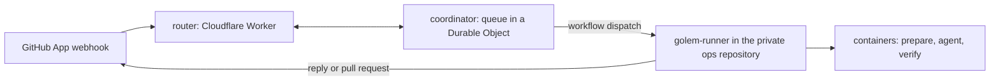

# Contributing

From a fresh clone to a merged change.
[SPEC.md](SPEC.md) says what golems do, [DEVELOPMENT.md](DEVELOPMENT.md) holds the rules and goals for this code, [OPERATIONS.md](OPERATIONS.md) how golems are run.

## How it fits together



The router decides whether and on whose seat a golem runs; the runner runs exactly one golem and publishes its verified result.
Router changes deploy from `trunk` automatically; runner changes reach golems only as a pinned release.

| Path | What |
|---|---|
| `router/` | the Worker: `src/lib.rs` is pure, host-tested policy; `src/edge.rs` and `src/edge/` do the wasm I/O; `src/coordinator.js` is the queue; `admin.*`, `registration.rs` and `seats.js` are the web pages |
| `runner/` | the native `golem-runner`: snapshot, containers, verification, publication; `agent.Dockerfile` defines the agent image |
| `x/` | the xtask behind most `mise` tasks |
| `tools/` | Nushell and Node scripts: deploy, release and its integrity check, container test, queue repair helper |
| `ops/` | byte-for-byte mirror of the private ops repository's workflows |
| `accept.nu`, `contract.nuon` | the acceptance judge and the promises it checks |
| `evidence/`, `history/` | release integrity records, dated decision and evidence logs |

## Setup

1. Install Git, [mise](https://mise.jdx.dev) and [rustup](https://rustup.rs); rustup takes Rust from `rust-toolchain.toml`, mise installs every other tool from `mise.toml`.
2. Clone, review `mise.toml` and run `mise trust` in the checkout, then check what mise cannot install for you, such as the MSVC build tools on Windows, WSL for the Worker suites and Docker:

   ```sh
   mise x nushell -- nu tools/doctor.nu
   ```

   It installs only Nushell, prints each missing prerequisite with its fix, and later runs as `mise run doctor`.
3. Run `mise install`, then `mise run ci`, the same gate CI runs; the first run builds for a while.

Code and tests behind `cfg(unix)` run only on Linux, so the coverage ratchet is enforced there and only reported on Windows.
You need no secrets for normal development.

## Everyday tasks

| Command | Does |
|---|---|
| `mise run ci` | formatting, Clippy, tests with coverage, wasm build, release packaging, Worker suites, workflow and Markdown checks; run it before every push |
| `mise run test` | only the tests |
| `mise run coverage` | line coverage per crate against `coverage.toml` |
| `mise run fmt` | formats Rust and TOML |
| `mise run doctor` | checks the prerequisites mise cannot install |
| `mise run test-agent` | builds the agent image and probes it with Docker |

## Making a change

1. Branch from `trunk`; one coherent change per pull request, with a short imperative commit subject such as `fix(router): ignore events sent by the App`.
2. Get `mise run ci` green locally, then open the pull request and explain context, problem and outcome in prose.
3. Merge once `ci` is green on the exact head and every review thread is resolved; `trunk` stays linear.
4. After the merge CI deploys the router; `/health` on the Worker shows the deployed commit.
5. A runner change is live only after a release, an integrity record and the ops pin, in the order [OPERATIONS.md](OPERATIONS.md#release-and-verify) describes; a router change that needs new runner fields waits for that pin.
6. Record decisions in [DECISIONS.md](DECISIONS.md) and the current state in [STATUS.md](STATUS.md).

Three things are never your call alone: limits and security boundaries, promises in `contract.nuon`, and runs that spend someone's seat, including `mise run accept`.
Nothing from a target repository, no code, log or credential, ever enters this public repository.

## Help

I build and run isp-golem-xiv; ask me, [@bugabinga](https://github.com/bugabinga).
