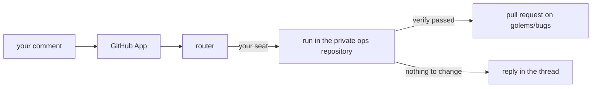

# isp-golem-xiv

Golems are coding agents that work on the repositories of isp-insoft-gmbh while nobody watches.
A golem is one Markdown file in a repository's `.golems/` directory: its frontmatter says when and how it runs, its body says what to do.
It answers in the thread or proposes a pull request, and a human decides what happens next.
Golems never merge, approve, or request changes.

Four rules shape everything else:

- **Golems are code.** They live in the repository they work on and get reviewed like any other change.
- **GitHub is the interface.** You meet golems in issues, pull requests and comments, nowhere else.
- **People pay with their own subscriptions.** Every run is charged to exactly one person's seat; nothing is pooled.
- **Everything is visible.** Every run says who started it, whose seat paid and which model worked.

## A golem

`.golems/bugs.md`:

```markdown
---
harness: codex
timeout: 45m
verify: mise run test
---
Reproduce the bug described in the thread with a failing test, then fix it.
Keep the change small and explain the cause in the pull request.
If you cannot reproduce it, say what you tried instead.
```

Then comment on an issue:

```text
@isp-golem-xiv bugs
The CSV export drops the last row when the list has exactly 100 entries.
```



The golem works in an isolated container on your subscription.
It publishes changes on its own branch `golems/bugs`, and only after `mise run test` passed on its changes.
A later mention continues that branch.

## Getting started

The GitHub App is installed on every repository of the organization, so nothing needs enabling.

1. Register a seat at [Seats](https://isp-golem-xiv.isp-insoft-gmbh.workers.dev/seats): Anthropic or OpenAI Codex, with a sign-in you use only for golems.
2. Add `.golems/<name>.md` to a repository; [SPEC.md](SPEC.md#the-golems-interface) lists every frontmatter field.
3. Comment `@isp-golem-xiv <name>` on an issue or pull request, followed by your instruction.

If you would rather start from a template, sign in at [/admin](https://isp-golem-xiv.isp-insoft-gmbh.workers.dev/admin) and choose **Create starter PR** for a repository you can write to: it adds house rules and a `hello` golem for review.

## Talking to golems

Only a comment whose first line starts with `@isp-golem-xiv` is a command.

| Comment | Does |
|---|---|
| `@isp-golem-xiv <name> [instruction]` | runs that golem on your seat |
| `@isp-golem-xiv` | lists the repository's golems |
| `@isp-golem-xiv seat` | shows your seats and the registration link |
| `@isp-golem-xiv stop` | cancels the run in this thread |

Golems can also run on a schedule (`schedule: daily`) or on repository events (`triggers: [issues.opened]`); those runs need an `owner` whose seat pays for them.

## What you see

- Eyes on your comment mean the App read it; a rocket means the run started.
- The `golem/<name>` check shows the outcome, whose seat paid, the harness and model, and a link to the private log.
- **Golems**, a pinned issue in each repository, lists its golems, their last results and a **Run now** box per golem.
- When something stops a run, the check says why on a `reason:` line; [OPERATIONS.md](OPERATIONS.md) explains each reason.

## Who pays

| Run started by | Paid by |
|---|---|
| your mention or **Run now** | you; without a seat the App tells you how to register one |
| a schedule, a bot, or CI | the golem's `owner` |
| an event caused by a member | that member if they have a seat, otherwise the `owner` |

Anthropic seats run Claude or Pi, OpenAI Codex seats run Codex or Pi.
If your seat does not fit the golem's preferred harness or provider, the run falls back and the check says what was asked for, what was used and why.

## Safety

- The agent runs in a container without GitHub credentials, the Docker socket or workflow files; the App publishes its verified result afterwards.
- Your sign-in is encrypted in your browser for the private ops repository; the router only relays ciphertext.
- Run logs stay in the private ops repository, because they contain target code.
- A repository's hooks and MCP servers run inside the agent's container and can reach its provider sign-in, so review them before you write golems for that repository.

## Documentation

- [OPERATIONS.md](OPERATIONS.md): seats, running and stopping golems, reading logs, the admin dashboard and troubleshooting.
- [SPEC.md](SPEC.md): what golems do and why.
- [DEVELOPMENT.md](DEVELOPMENT.md): how this repository is built, tested and released.
- [DECISIONS.md](DECISIONS.md) and [STATUS.md](STATUS.md): why things are the way they are, and where they stand.

I build and run isp-golem-xiv; questions and ideas go to me, [@bugabinga](https://github.com/bugabinga).

Licensed under the [MIT License](LICENSE).
