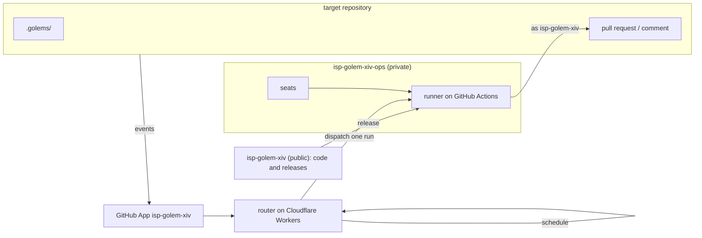

# isp-golem-xiv

This document states what the product does and why; how it is built is left to the implementation.
Names, markers, limits, and provider ids are defined once in [contract.nuon](contract.nuon).

## Overview

`isp-golem-xiv` runs golems for every repository of `isp-insoft-gmbh`.
A golem is one Markdown file in a repository's `.golems/` directory.
It says when it wakes up and what it does.
Golems work unattended and leave a pull request or a comment for a human to judge.
Golems never merge, approve, or request changes.

Principles:

- **GitHub Actions is the compute.** Golems run as jobs in the ops repository, with the target's toolchain from its `mise` description.
- **People pay with their own subscriptions.** Every run is charged to exactly one person's seat; seats are never shared or pooled.
- **Golems are code.** Definitions live in the repository they act on and are reviewed like any other change.
- **GitHub is the interface.** People meet golems only in pull requests, issues, and comments.
- **Everything is visible.** Every run says who triggered it, whose seat paid, and what it used.

## Non-goals

- Running agents outside GitHub Actions.
- Holding credentials anywhere but encrypted in the ops repository.
- Retries and catch-up of missed schedules.
- Forges other than GitHub.
- API keys; only subscription sign-ins are supported.

## Architecture

| Part | Does |
|---|---|
| GitHub App `isp-golem-xiv` | the identity everything acts under; delivers events |
| router | decides whether and how a golem runs, dispatches it, answers people |
| runner | runs exactly one golem in one job and publishes the result |
| code repository `isp-golem-xiv` | public, MIT-licensed source of router and runner, with tests and releases |
| ops repository `isp-golem-xiv-ops` | private; runs released runners, holds the seats, and keeps every golem run's logs, because logs contain target code |
| target repository | holds `.golems/` and its toolchain description |

Decisions:

- Router and runner are written in Rust.
- The router runs on Cloudflare Workers Free and keeps only data it can rebuild from the repositories.
- The runner is a single generic workflow; everything golem-specific arrives as parameters.
- Target repositories describe their toolchain with `mise`; golems do not install tools themselves.

## The `.golems/` interface

A repository with a `.golems/` directory is enabled.
`.golems/_golems.md` holds optional house rules that apply to every golem of the repository.
House rules contain only what applies to golems and not to humans, because harnesses already load the repository's own instructions.

Each `.golems/<name>.md` has frontmatter followed by the task in plain prose.

| Field | Meaning |
|---|---|
| `triggers` | GitHub events the golem reacts to, as `<event>` or `<event>.<action>`, e.g. `issues.opened` |
| `schedule` | days on which it runs, in UTC, e.g. `daily` or `[mon, thu]`; the router picks the hour |
| `owner` | person whose seat pays when no person triggered the run; required with `triggers` or `schedule` |
| `harness` | preferred harness: `claude`, `pi`, or `codex` |
| `model`, `effort`, `provider` | preferred model settings |
| `branch` | branch the golem owns and continues across runs; default `golems/<name>` |
| `timeout` | wall-clock budget per run, e.g. `30m`; default `30m`, at most `5h` |
| `verify` | command that must pass before anything is published |
| `runner` | label of a GitHub-hosted runner available on the organization's plan; default `ubuntu-latest` |

A golem with neither `triggers` nor `schedule` runs only when a person asks for it.
A golem with invalid frontmatter is disabled and reported; the rest keep working.
The names `stop`, `seat`, and `help` are reserved and invalid as golem names.

## Triggers

| Trigger | Starts when |
|---|---|
| mention | a person comments `@isp-golem-xiv <golem> [instructions]` on an issue or pull request |
| dashboard | a person ticks the golem's run box in the dashboard issue |
| event | a GitHub event matches the golem's `triggers` |
| schedule | the golem's day comes; once per day |

Only a comment whose first line starts with `@isp-golem-xiv` is a command; mentions further down are text.
Events caused by `isp-golem-xiv` itself never trigger golems.
Two runs of the same golem in the same repository never overlap.
A run that has to wait for another one waits; it is never dropped or cancelled.

## Seats

A seat is one person's subscription at one provider.
Seats make cost and audit attributable to a person and a provider.

### Who pays

| Run started by | Seat holder |
|---|---|
| an organization member: mention or dashboard | that person; without a seat the run is refused |
| an event caused by an organization member | that person if they have a seat, otherwise the golem's `owner` |
| a schedule, a bot, or CI | the golem's `owner` |
| anyone else | nobody; the run does not start |

Only organization members can be seat holders.
A golem's `owner` agrees to pay for its unattended runs by being named.
Runs on the same seat never overlap, because rotating sign-ins would invalidate each other.

### Which seat and model

The golem's harness, model, and provider are preferences.
Nobody needs a seat at every provider.

1. If the seat holder has a seat at the golem's provider, the run uses the golem's harness and model.
2. Otherwise it uses the seat holder's preferred seat, chosen on the registration page and kept as an ops repository variable.
3. The harness stays if it works with that provider; otherwise it becomes `pi`, which works with all providers.
4. The model becomes that harness's default for the provider.
5. Without any seat the run is refused with a link to register one.

A fallback always says so: what was asked for, what was used, and why.
Repositories whose teams use several providers keep instructions for all their harnesses themselves.

### Credentials

People sign in with their provider's own command-line tool and register the result on a page served by the router.
The credential is encrypted in the browser; the router stores it without ever seeing it.

| Provider | Sign-in | Behaviour |
|---|---|---|
| `anthropic` | `claude setup-token` | valid for a year, does not change |
| `openai-codex`, `github-copilot` | a fresh sign-in used only for golems | refreshes when the provider requires it; the run writes the new sign-in back |

- A refreshing sign-in must be separate from the one a person uses daily; otherwise one of them is logged out.
- One seat serves every harness that works with its provider; which harnesses those are is listed in `contract.nuon`.
- Each harness uses its own default model for a provider unless the golem names one.
- A sign-in that expired or was revoked must be registered again; the dashboards warn before a known expiry.
- Registering again always replaces the previous sign-in.
- People are responsible for using their accounts within their providers' terms.

## Runs

A run checks out the target, prepares its toolchain, gives the agent the house rules, the golem's task, and the triggering context, and lets it work within `timeout`.
The result is judged by what is observable, not by what the agent claims.

| Outcome | Meaning | Visible as |
|---|---|---|
| `changed` | commits passed `verify` and were published | pull request on the golem's branch |
| `replied` | the golem answered without changing code | comment |
| `no_change` | nothing to do, with the reason | check run, dashboard |
| `incomplete` | budget used up; the next run continues on `branch` | pull request, dashboard |
| `blocked` | needs a human | label on the pull request, dashboard |
| `stopped` | a person stopped it | check run, dashboard |

A run started by a person always answers that person; `no_change` is the outcome of runs without a person to answer.

## Human interface

Every surface answers three questions: what can I do here, whose seat pays, what happens next.

### Onboarding

1. An organization admin adds the repository to the App.
2. If `.golems/` is missing, `isp-golem-xiv` opens the pull request **Enable golems**.
3. It adds `.golems/_golems.md` with a single line, `You are a golem working unattended in this repository.`, and `.golems/hello.md`, a golem that changes nothing and reports what it sees.
4. The description explains how house rules work, shows whether the repository has a toolchain description, and tells readers to check their seat with `@isp-golem-xiv seat`.
5. Merging enables golems; closing leaves the repository alone until someone adds `.golems/`.

### Dashboard issue

When `.golems/` lands, `isp-golem-xiv` opens and pins the issue **Golems** and keeps it current.

| Section | Content |
|---|---|
| Golems | purpose, when it wakes, who pays, last outcome with the seat and model used, a run box for golems people may start |
| Disabled | golems with invalid frontmatter and the reason |
| Talk to golems | the mention commands |
| Seats | in private repositories: people who registered a seat and their providers, plus seats of people who left the organization; in public repositories only how to check your own seat |

### Mentions

| Comment | Does |
|---|---|
| `@isp-golem-xiv` | lists the golems available here and the seat and model each would use for you |
| `@isp-golem-xiv <golem> [instructions]` | runs the golem here |
| `@isp-golem-xiv stop` | stops the golem run started here |
| `@isp-golem-xiv seat` | shows your seats and links to registration |

### Feedback

| Moment | Signal |
|---|---|
| mention seen | 👀 reaction |
| run started | 🚀 reaction and a check run with seat, model, budget, log link, and how to stop it |
| run finished | outcome in the check run, the dashboard, and the pull request or comment |
| refused | a reply with what was refused, why, and the one step that fixes it |
| `.golems/` changed in a pull request | a check that validates the golems before merge |

### Admin dashboard

The router serves a web page for the whole organization.
Every organization member can open it after signing in with GitHub.

| Section | Content |
|---|---|
| Runs | the last 30 days: repository, golem, trigger, seat, model, outcome, duration, log link |
| Usage | runs and time per person and provider |
| Health | failure rate, blocked runs, refreshing seats close to expiry |
| Seats | registered seats per person, and seats of people who left the organization |
| Repositories | enabled repositories and disabled golems |

Everything shown is derived from GitHub: runs in the ops repository with one machine-readable audit record each, seat names, the App installation, and the golem index.
The implementation chooses the audit record's form and records it in `DECISIONS.md`.
The dashboard keeps no data of its own beyond rebuildable caches, works within Workers Free limits, and never shows a credential.
Log links lead to the ops repository, so only people with access to it can read logs.

## Security

- Only organization members can start golems by mention or dashboard; events and schedules start them only on a member's or the `owner`'s seat.
- Issue, pull request, comment, and repository content is untrusted input for the agent.
- The agent never holds a GitHub token or the App's private key; the runner publishes its results afterwards, with a token limited to the target repository.
- The runner never publishes text that contains a credential it handled.
- Golems may change only the target repository, and never its `.golems/`, workflows, or harness configuration.
- Credentials exist only encrypted in the ops repository and in the run that uses them.
- Nothing from a target repository ever reaches the public code repository.
- The router never sees a credential.

## Assumptions

- Cloudflare Workers Free is enough for the router; if not, the usage reports will show it.
- The free plan's included Actions minutes for private repositories are enough while the allowlist is in place; the admin dashboard shows usage.
- At most 100 seats fit, the limit of repository secrets in the ops repository.
- Provider terms allow an organization to hold its members' subscription sign-ins for runs they trigger; people remain responsible for their own accounts.
